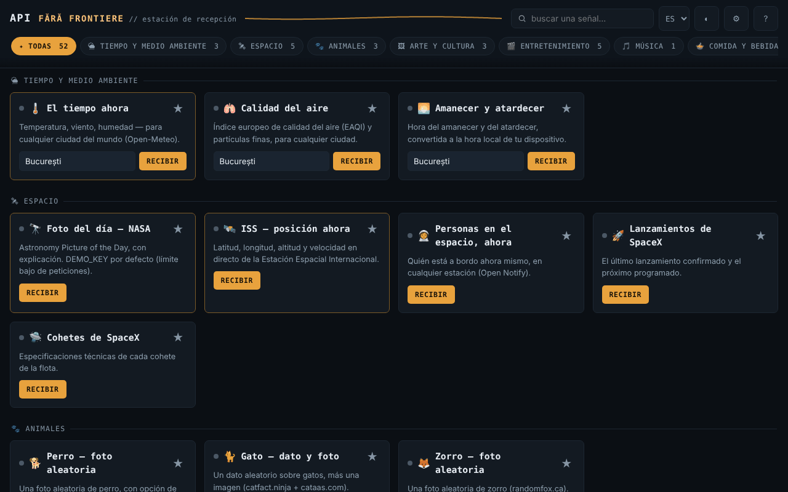

# API fără frontiere — estación de recepción · v1.1.0

[English](README.md) · [Română](README.ro.md) · [Français](README.fr.md) · [Italiano](README.it.md) · **Español** · [Português](README.pt.md) · [Deutsch](README.de.md) · [Magyar](README.hu.md)

**Versión:** 1.2.1 · **Última actualización:** 2026-10-22

Idiomas de la interfaz: **Română, English, Français, Italiano, Español, Português (PT), Deutsch, Magyar**

Un único archivo HTML con 52 widgets (47 sobre API públicas — tiempo, espacio, arte, libros, tipo de cambio, comprobación de contraseñas, etc. — y 5 utilidades locales que funcionan sin conexión), sin cuenta, sin telemetría propia, sin servidor propio.

**Aplicación en línea:** https://chiuta.github.io/API-fara-frontiere/

## Qué es

Una página índice de «estaciones»: cada tarjeta consulta directamente, desde tu navegador, una API pública gratuita y muestra el resultado. No existe ningún servidor intermedio del autor. A diferencia de las aplicaciones sin conexión de la misma serie, esta **necesita internet** para mostrar datos: el archivo en sí no contiene los datos, solo la interfaz.

Los 52 widgets se agrupan en 16 categorías: Tiempo & Medio ambiente, Espacio, Animales, Arte & Cultura, Entretenimiento, Música, Comida & Bebida, Finanzas & Cripto, Países & Geografía, Palabras & Conocimiento, Humor & Inspiración, Seguridad, Salud, Identidad & Datos de prueba, Desarrollo & Utilidades, Local · sin red.

## Funciones

Verificadas en el código y en pruebas automáticas con respuestas simuladas (no pude usar la red externa durante la verificación):

- 52 tarjetas (47 en línea + 5 locales), con búsqueda (sin distinguir signos diacríticos), filtrado por categoría y favoritos (★, conservados en local).
- Cada solicitud tiene un tiempo de espera de 12 s; en caso de fallo la tarjeta muestra la causa (red no disponible, tiempo agotado, HTTP nnn) y un botón «Reintentar». El botón de solicitud queda bloqueado mientras hay una solicitud en curso; Intro en los campos lanza la solicitud.
- Los datos recibidos de las API se escapan antes de mostrarse; los enlaces externos solo se aceptan si son `http(s)`.
- «¿Contraseña comprometida?»: calcula el SHA-1 en local y envía a Have I Been Pwned solo los primeros 5 caracteres de la huella (k-anonimato); la contraseña no sale del navegador.
- **Local · sin red** (sin solicitudes, funcionan sin conexión): generador de contraseñas (`crypto.getRandomValues`, sin sesgo, entropía estimada), UUID v4, hash de texto (SHA-256/384/512, SHA-1, Web Crypto — requiere un contexto seguro), tiempo Unix ↔ fecha, Base64 UTF-8; botón «Copiar».
- **Sin conexión:** barra de aviso cuando no tienes conexión (con un atajo a las tarjetas locales); ante un error de red/tiempo agotado, la tarjeta muestra bajo el error el último resultado correcto, conservado en local como texto (opcional, se puede desactivar y borrar desde Ajustes; no se conserva para «¿Contraseña comprometida?», «Mi dirección IP» ni las tarjetas locales).
- Clave NASA opcional (Ajustes ⚙), `DEMO_KEY` por defecto.
- Tema oscuro/claro, Ajustes, «Fuentes y atribuciones».

## Manual de uso

1. Abre la página. Las 3 estaciones principales (El tiempo ahora, Foto del día de la NASA, ISS) se cargan solas; puedes desactivarlo en Ajustes ⚙ (se aplica en la próxima apertura).
2. Busca una tarjeta en el campo superior o elige una categoría en la barra de filtros.
3. Rellena el campo de la tarjeta (ciudad, nombre, código, etc.), si lo hay, y pulsa **Recibir** (o Intro).
4. Si aparece «Señal perdida», pulsa **Reintentar** o prueba más tarde: las fuentes de terceros pueden no estar disponibles o limitar el tráfico.
5. Marca tus tarjetas favoritas con ★ para que aparezcan primero en su categoría.
6. En Ajustes ⚙ puedes guardar una clave NASA propia (gratuita, en api.nasa.gov) y desactivar la carga automática; «Fuentes y atribuciones» enumera los proveedores.

## Privacidad y red

- **Almacenamiento local (`localStorage`):** `aff_theme` (tema), `aff_favs` (favoritos), `aff_nasa_key` (la clave NASA, en claro, si la guardas), `aff_auto_hero` (carga automática), `aff_last` (último resultado de las tarjetas, como texto, máx. 600 caracteres por tarjeta) y `aff_keep_last` (la opción de conservarlo). No se usan cookies, `sessionStorage` ni IndexedDB. Si el almacenamiento está bloqueado (modo privado), la aplicación funciona sin él.
- **Al abrir se contactan automáticamente 3 fuentes** (si no desactivas la carga automática en Ajustes): `geocoding-api.open-meteo.com` y `api.open-meteo.com` (la ciudad de la tarjeta «El tiempo ahora», Bucarest por defecto), `api.nasa.gov` (tu clave o `DEMO_KEY`; más la imagen de `apod.nasa.gov`) y `api.wheretheiss.at`. Con la carga automática desactivada, al abrir no se envía ninguna solicitud (probado).
- **Todas las demás tarjetas contactan con su fuente solo después de pulsar el botón** de la tarjeta. Lo que escribes (ciudad, nombre, NIF-IVA, VIN, código de barras, texto para el QR, etc.) se envía a esa fuente; el texto para el código QR va a `api.qrserver.com`.
- Cada fuente contactada ve tu dirección IP. Las solicitudes se envían sin cookies y sin cabecera Referer.
- La página tiene una `Content-Security-Policy` (meta); el script propio se permite mediante hash SHA-256 (sin `'unsafe-inline'` en `script-src`), y `connect-src` es una lista de dominios: `connect-src` contiene exactamente los hosts a los que llama el código (verificado por inventario). La lista de imágenes (`img-src`) incluye también hosts en los que las imágenes las indican las respuestas de las API (p. ej. `image.tmdb.org`, `*.archive.org`, `raw.githubusercontent.com`); esto no pudo confirmarse sin red.
- Hosts de las API: open-meteo (3 subdominios), sunrise-sunset.org, nasa.gov, wheretheiss.at, open-notify.org, spacexdata.com, dog.ceo, catfact.ninja, randomfox.ca, artic.edu, metmuseum.org, openlibrary.org, ghibliapi.vercel.app, tvmaze.com, rickandmortyapi.com, pokeapi.co, deckofcardsapi.com, itunes.apple.com, themealdb.com, thecocktaildb.com, openfoodfacts.org, frankfurter.dev, coingecko.com, vatcomply.com, restcountries.com, date.nager.at, dictionaryapi.dev, ro/en.wikipedia.org, numbersapi.com, opentdb.com, jokeapi.dev, chucknorris.io, adviceslip.com, pwnedpasswords.com, api.fda.gov, disease.sh, genderize.io, agify.io, nationalize.io, randomuser.me, api.github.com, hacker-news.firebaseio.com, vpic.nhtsa.dot.gov, universities.hipolabs.com, ipapi.co.
- Permisos del navegador: ninguno.

## Límites y advertencias

- La aplicación no controla las API: pueden caerse, cambiar de formato, limitar las solicitudes o devolver datos antiguos. No pude verificar desde el entorno de pruebas la disponibilidad, el CORS, las claves ni los límites actuales de ninguna de ellas; las condiciones de cada proveedor deben consultarse directamente en la fuente. Conocidas como frágiles/no verificadas: Open Notify (solo HTTP, no seguro), SpaceX-API (datos de la comunidad, posiblemente desactualizados), NumbersAPI, disease.sh (archivo), CoinGecko e ipapi.co (límites para el acceso sin clave), TheMealDB/TheCocktailDB (clave pública de prueba).
- Los datos de los widgets son informativos. **Prospecto de medicamento (FDA):** texto en inglés, solo para productos de EE. UU.; no es consejo médico ni sustituye al médico o al farmacéutico. **Tipo de cambio, criptomonedas, IVA:** no son asesoramiento financiero ni confirmación oficial. **Predicción a partir del nombre:** estimación estadística, a menudo errónea; no la uses para tomar decisiones sobre personas.
- Las imágenes de la NASA, museos, TVmaze, etc. pueden tener derechos de autor o licencias propias; la tarjeta de la NASA muestra el crédito cuando se facilita. Véase «Fuentes y atribuciones» en la aplicación.
- El widget «Dato de Chuck Norris» muestra chistes absurdos tomados de una API de terceros (se evita la categoría «explicit», el filtrado no está garantizado).
- Verificado con respuestas simuladas, no con los servidores reales.

## Ejecución local / sin conexión

Descarga `index.html` y ábrelo en el navegador. La interfaz arranca sin internet, pero las tarjetas solo muestran datos con conexión a internet.

## Historial / Changelog

### 1.2.1 — 2026-10-22
- El título de la página (document.title) ahora sigue el idioma de la interfaz en lugar de conservar el sufijo rumano.

### 1.1.0 — 2026-10-14
- Copia de seguridad y etiquetado de datos (fff-kit).

### 12 de octubre de 2026 — versión 1.0.4
- 1.0.4 — 2026-10-12: la versión y la fecha de la última actualización se muestran en la aplicación

### 11 de octubre de 2026 (tercera pasada) — versión 1.0.3
- La carga automática de las 3 estaciones ya no se inicia mientras el navegador informa «sin conexión» (sin errores rojos inútiles); las solicitudes aplazadas se ejecutan una sola vez al reconectar. Estilo de impresión (solo las estaciones, sin controles). CSP: hash recalculado.

### 11 de octubre de 2026 (segunda pasada) — versión 1.0.2
- Nueva categoría «Local · sin red» con 5 utilidades que funcionan sin internet (generador de contraseñas, UUID v4, hash, tiempo Unix, Base64); barra de aviso sin conexión; el último resultado guardado aparece bajo los errores de red (opcional, borrable); 52 widgets en 16 categorías; CSP: hash recalculado (sin hosts nuevos).

### 11 de octubre de 2026
- Versión 1.0.1 (se muestra en «Acerca de la estación»).
- Accesibilidad: el título «API fără frontiere» es ahora un `<h1>` y los títulos de las tarjetas son `<h2>` (orden correcto de los encabezados); axe-core informa de 0 infracciones a 1280 y 360 px.
- CSP: `script-src` usa un hash SHA-256 en lugar de `'unsafe-inline'`.
- La ventana «Fuentes y atribuciones» señala explícitamente que la disponibilidad/el formato de las API no pudieron volver a verificarse el 11 de octubre de 2026 (sin acceso a la red); el widget «¿Contraseña comprometida?» se volvió a probar con una respuesta simulada (funciona).

**Fuentes verificadas el 11.10.2026:** ninguna: el estado de las API de terceros (NumbersAPI, disease.sh, SpaceX-API, ipapi.co, etc.) no pudo confirmarse en fuentes primarias el 11.10.2026; la lista mantiene la advertencia existente.

## Licencia

MIT — véase el archivo LICENSE.

## Autor

Alexio — Alexandru-Ionuț Chiuță, contacto: alexio@trom.tf

## Resumen

API fără frontiere es un panel HTML en un único archivo con 52 widgets (47 sobre API públicas gratuitas más 5 herramientas locales que funcionan sin conexión) (tiempo, espacio, arte, libros, divisas, comprobación de filtración de contraseñas, etc.), sin cuenta y sin telemetría propia. A diferencia de las aplicaciones sin conexión de esta serie, necesita internet para mostrar datos. Tres widgets (tiempo, imagen de la NASA, ISS) se cargan automáticamente al abrir salvo que se desactiven en Ajustes; todos los demás widgets contactan con su fuente solo cuando pulsas su botón, y cada fuente ve tu dirección IP. Los datos se probaron solo con respuestas simuladas; la disponibilidad y las condiciones de las API de terceros no están verificadas. Licencia: MIT (véase LICENSE).
