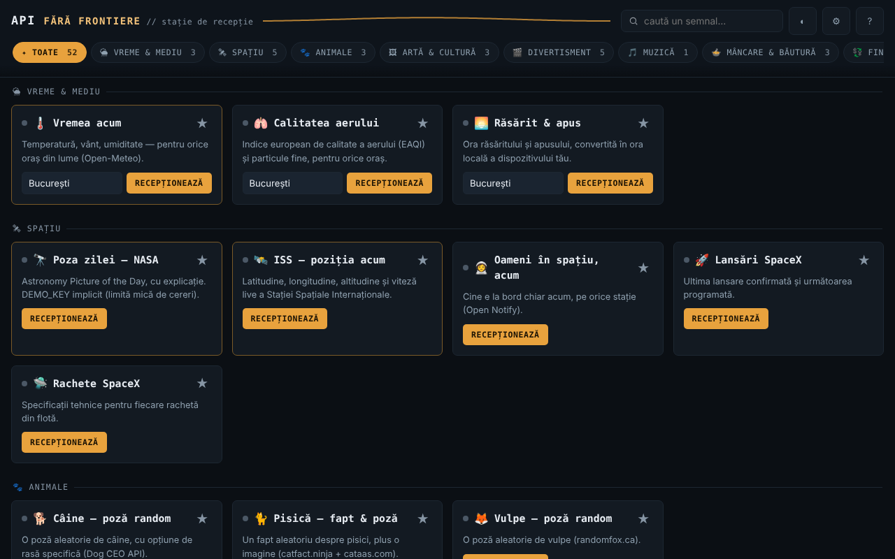

# API fără frontiere — station de réception · v1.1.0

[English](README.md) · [Română](README.ro.md) · **Français** · [Italiano](README.it.md) · [Español](README.es.md) · [Português](README.pt.md) · [Deutsch](README.de.md) · [Magyar](README.hu.md)

**Version :** 1.1.0 · **Dernière mise à jour :** 2026-10-14

Un seul fichier HTML avec 52 widgets (47 sur des API publiques — météo, espace, art, livres, taux de change, vérification de mot de passe, etc. — et 5 utilitaires locaux qui fonctionnent hors ligne), sans compte, sans télémétrie propre, sans serveur propre.

**Application en ligne :** https://chiuta.github.io/API-fara-frontiere/

## De quoi s'agit-il

Une page-index de « stations » : chaque carte interroge directement, depuis votre navigateur, une API publique gratuite et affiche le résultat. Il n'existe aucun serveur intermédiaire de l'auteur. Contrairement aux applications hors ligne de la même série, celle-ci **a besoin d'internet** pour afficher des données : le fichier lui-même ne contient pas les données, seulement l'interface.

Les 52 widgets sont regroupés en 16 catégories : Météo & Environnement, Espace, Animaux, Art & Culture, Divertissement, Musique, Nourriture & Boissons, Finance & Crypto, Pays & Géographie, Mots & Connaissances, Humour & Inspiration, Sécurité, Santé, Identité & Données de test, Développement & Utilitaires, Local · hors réseau.

## Fonctions

Vérifiées dans le code et par des tests automatisés avec des réponses simulées (je n'ai pas pu utiliser le réseau externe lors de la vérification) :

- 52 cartes (47 en ligne + 5 locales), avec recherche (insensible aux diacritiques), filtrage par catégorie et favoris (★, conservés localement).
- Chaque requête a un délai d'attente de 12 s ; en cas d'échec, la carte affiche la cause (réseau indisponible, délai dépassé, HTTP nnn) et un bouton « Réessayer ». Le bouton de requête est bloqué pendant qu'une requête est en cours ; Entrée dans les champs déclenche la requête.
- Les données reçues des API sont échappées avant l'affichage ; les liens externes ne sont acceptés que s'ils sont en `http(s)`.
- « Mot de passe compromis ? » : calcule le SHA-1 localement et n'envoie à Have I Been Pwned que les 5 premiers caractères de l'empreinte (k-anonymat) ; le mot de passe ne quitte pas le navigateur.
- **Local · hors réseau** (aucune requête, fonctionne hors ligne) : générateur de mots de passe (`crypto.getRandomValues`, sans biais, entropie estimée), UUID v4, hachage de texte (SHA-256/384/512, SHA-1, Web Crypto — requiert un contexte sécurisé), temps Unix ↔ date, Base64 UTF-8 ; bouton « Copier ».
- **Hors ligne :** barre d'avertissement lorsque vous n'avez pas de connexion (avec un raccourci vers les cartes locales) ; en cas d'erreur réseau/délai dépassé, la carte affiche sous l'erreur le dernier résultat obtenu, conservé localement sous forme de texte (facultatif, désactivable et effaçable depuis les Paramètres ; il n'est pas conservé pour « Mot de passe compromis ? », « Mon adresse IP » et les cartes locales).
- Clé NASA facultative (Paramètres ⚙), `DEMO_KEY` par défaut.
- Thème sombre/clair, Paramètres, « Sources et attributions ».

## Mode d'emploi

1. Ouvrez la page. Les 3 stations principales (La météo maintenant, Photo du jour NASA, ISS) se chargent d'elles-mêmes ; vous pouvez désactiver cela dans les Paramètres ⚙ (pris en compte à la prochaine ouverture).
2. Cherchez une carte dans le champ du haut ou choisissez une catégorie dans la barre de filtres.
3. Renseignez le champ de la carte (ville, nom, code, etc.), s'il y en a un, et appuyez sur **Recevoir** (ou Entrée).
4. Si « Signal perdu » apparaît, appuyez sur **Réessayer** ou réessayez plus tard : les sources tierces peuvent être indisponibles ou limiter le trafic.
5. Marquez vos cartes préférées avec ★ pour qu'elles apparaissent en premier dans leur catégorie.
6. Dans les Paramètres ⚙, vous pouvez enregistrer votre propre clé NASA (gratuite, sur api.nasa.gov) et désactiver le chargement automatique ; « Sources et attributions » liste les fournisseurs.

## Confidentialité et réseau

- **Stockage local (`localStorage`) :** `aff_theme` (thème), `aff_favs` (favoris), `aff_nasa_key` (la clé NASA, en clair, si vous l'enregistrez), `aff_auto_hero` (chargement automatique), `aff_last` (dernier résultat des cartes, sous forme de texte, 600 caractères maximum par carte) et `aff_keep_last` (option pour le conserver). Aucun cookie, `sessionStorage` ou IndexedDB n'est utilisé. Si le stockage est bloqué (mode privé), l'application fonctionne sans lui.
- **À l'ouverture, 3 sources sont contactées automatiquement** (si vous ne désactivez pas le chargement automatique dans les Paramètres) : `geocoding-api.open-meteo.com` et `api.open-meteo.com` (la ville de la carte « La météo maintenant », Bucarest par défaut), `api.nasa.gov` (votre clé ou `DEMO_KEY` ; plus l'image de `apod.nasa.gov`) et `api.wheretheiss.at`. Avec le chargement automatique désactivé, aucune requête n'est envoyée à l'ouverture (testé).
- **Toutes les autres cartes ne contactent leur source qu'après un appui sur le bouton** de la carte. Ce que vous saisissez (ville, nom, numéro de TVA, VIN, code-barres, texte pour le QR, etc.) est envoyé à la source concernée ; le texte pour le code QR va à `api.qrserver.com`.
- Chaque source contactée voit votre adresse IP. Les requêtes sont envoyées sans cookies et sans en-tête Referer.
- La page a une `Content-Security-Policy` (meta) ; le script propre est autorisé par hash SHA-256 (sans `'unsafe-inline'` dans `script-src`), et `connect-src` est une liste de domaines : `connect-src` contient exactement les hôtes appelés par le code (vérifié par inventaire). La liste des images (`img-src`) inclut aussi des hôtes où les images sont indiquées par les réponses des API (par ex. `image.tmdb.org`, `*.archive.org`, `raw.githubusercontent.com`) ; cela n'a pas pu être confirmé sans réseau.
- Hôtes d'API : open-meteo (3 sous-domaines), sunrise-sunset.org, nasa.gov, wheretheiss.at, open-notify.org, spacexdata.com, dog.ceo, catfact.ninja, randomfox.ca, artic.edu, metmuseum.org, openlibrary.org, ghibliapi.vercel.app, tvmaze.com, rickandmortyapi.com, pokeapi.co, deckofcardsapi.com, itunes.apple.com, themealdb.com, thecocktaildb.com, openfoodfacts.org, frankfurter.dev, coingecko.com, vatcomply.com, restcountries.com, date.nager.at, dictionaryapi.dev, ro/en.wikipedia.org, numbersapi.com, opentdb.com, jokeapi.dev, chucknorris.io, adviceslip.com, pwnedpasswords.com, api.fda.gov, disease.sh, genderize.io, agify.io, nationalize.io, randomuser.me, api.github.com, hacker-news.firebaseio.com, vpic.nhtsa.dot.gov, universities.hipolabs.com, ipapi.co.
- Autorisations du navigateur : aucune.

## Limites et avertissements

- L'application n'a aucun contrôle sur les API : elles peuvent tomber, changer de format, limiter les requêtes ou renvoyer des données anciennes. Je n'ai pas pu vérifier depuis l'environnement de test la disponibilité, le CORS, les clés ou les limites actuelles d'aucune d'entre elles ; les conditions de chaque fournisseur doivent être consultées directement à la source. Connus comme fragiles/non vérifiés : Open Notify (HTTP seulement, non sécurisé), SpaceX-API (données communautaires, éventuellement non à jour), NumbersAPI, disease.sh (archive), CoinGecko et ipapi.co (limites pour l'accès sans clé), TheMealDB/TheCocktailDB (clé publique de test).
- Les données des widgets sont données à titre informatif. **Notice de médicament (FDA) :** texte en anglais, uniquement pour des produits des États-Unis ; ce n'est pas un avis médical et cela ne remplace pas le médecin ou le pharmacien. **Taux de change, cryptomonnaies, TVA :** ni conseil financier ni confirmation officielle. **Prédiction à partir du prénom :** estimation statistique, souvent erronée ; ne l'utilisez pas pour des décisions concernant des personnes.
- Les images de la NASA, des musées, de TVmaze, etc. peuvent être soumises à des droits d'auteur ou à des licences propres ; la carte NASA affiche le crédit lorsqu'il est fourni. Voir « Sources et attributions » dans l'application.
- Le widget « Fait Chuck Norris » affiche des blagues absurdes issues d'une API tierce (la catégorie « explicit » est évitée, le filtrage n'est pas garanti).
- Vérifié avec des réponses simulées, pas avec les vrais serveurs.

## Exécution locale / hors ligne

Téléchargez `index.html` et ouvrez-le dans un navigateur. L'interface démarre sans internet, mais les cartes n'affichent des données qu'avec une connexion internet.

## Historique / Changelog

### 1.1.0 — 2026-10-14
- Sauvegarde et étiquetage des données (fff-kit).

### 12 octobre 2026 — version 1.0.4
- 1.0.4 — 2026-10-12 : la version et la date de la dernière mise à jour sont affichées dans l'application

### 11 octobre 2026 (troisième passage) — version 1.0.3
- Le chargement automatique des 3 stations ne démarre plus tant que le navigateur signale « hors ligne » (plus d'erreurs rouges inutiles) ; les requêtes différées s'exécutent une seule fois à la reconnexion. Style d'impression (uniquement les stations, sans commandes). CSP : hash recalculé.

### 11 octobre 2026 (deuxième passage) — version 1.0.2
- Nouvelle catégorie « Local · hors réseau » avec 5 utilitaires qui fonctionnent sans internet (générateur de mots de passe, UUID v4, hachage, temps Unix, Base64) ; barre hors ligne ; le dernier résultat enregistré apparaît sous les erreurs réseau (facultatif, effaçable) ; 52 widgets en 16 catégories ; CSP : hash recalculé (aucun nouvel hôte).

### 11 octobre 2026
- Version 1.0.1 (affichée dans « À propos de la station »).
- Accessibilité : le titre « API fără frontiere » est désormais un `<h1>` et les titres des cartes sont des `<h2>` (ordre correct des titres) ; axe-core signale 0 violation à 1280 et 360 px.
- CSP : `script-src` utilise un hash SHA-256 au lieu de `'unsafe-inline'`.
- La fenêtre « Sources et attributions » indique explicitement que la disponibilité/le format des API n'ont pas pu être revérifiés le 11 octobre 2026 (sans accès au réseau) ; le widget « Mot de passe compromis ? » a été retesté avec une réponse simulée (il fonctionne).

**Sources vérifiées le 11.10.2026 :** aucune : le statut des API tierces (NumbersAPI, disease.sh, SpaceX-API, ipapi.co, etc.) n'a pas pu être confirmé auprès de sources primaires le 11.10.2026 ; la liste conserve l'avertissement existant.

## Licence

MIT — voir le fichier LICENSE.

## Auteur

Alexio — Alexandru-Ionuț Chiuță, contact : alexio@trom.tf

## Résumé

API fără frontiere est un tableau de bord HTML en un seul fichier de 52 widgets (47 sur des API publiques gratuites plus 5 outils locaux qui fonctionnent hors ligne) (météo, espace, art, livres, devises, vérification de fuite de mot de passe, etc.), sans compte et sans télémétrie propre. Contrairement aux applications hors ligne de cette série, il a besoin d'internet pour afficher des données. Trois widgets (météo, image NASA, ISS) se chargent automatiquement à l'ouverture sauf désactivation dans les Paramètres ; tous les autres widgets ne contactent leur source que lorsque vous appuyez sur leur bouton, et chaque source voit votre adresse IP. Les données n'ont été testées qu'avec des réponses simulées ; la disponibilité et les conditions des API tierces ne sont pas vérifiées. Licence : MIT (voir LICENSE).
