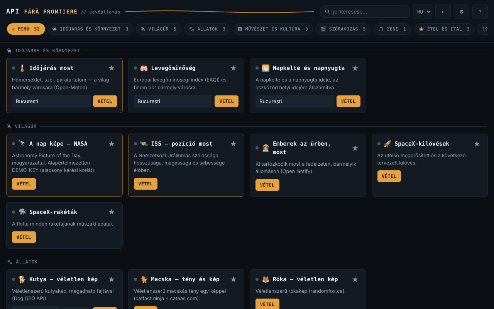

# API fără frontiere — vevőállomás · v1.1.0

[English](README.md) · [Română](README.ro.md) · [Français](README.fr.md) · [Italiano](README.it.md) · [Español](README.es.md) · [Português](README.pt.md) · [Deutsch](README.de.md) · **Magyar**

**Verzió:** 2.0.1 · **Utolsó frissítés:** 2026-10-27

A felület nyelvei: **Română, English, Français, Italiano, Español, Português (PT), Deutsch, Magyar**

Egyetlen HTML-fájl 52 widgettel (47 nyilvános API-ra épül — időjárás, világűr, művészet, könyvek, árfolyam, jelszóellenőrzés stb. — és 5 helyi segédprogram, amely offline is működik), fiók, saját telemetria és saját szerver nélkül.

**Online alkalmazás:** https://chiuta.github.io/API-fara-frontiere/

## Mi ez

„Állomások” indexoldala: minden kártya közvetlenül a böngésződből lekérdez egy ingyenes nyilvános API-t, és megjeleníti az eredményt. A szerzőnek nincs közvetítő szervere. Az ugyanebbe a sorozatba tartozó offline alkalmazásokkal ellentétben ez **internetet igényel** az adatok megjelenítéséhez: maga a fájl nem tartalmazza az adatokat, csak a felületet.

Az 52 widget 16 kategóriába van csoportosítva: Időjárás & Környezet, Világűr, Állatok, Művészet & Kultúra, Szórakozás, Zene, Étel & Ital, Pénzügy & Kripto, Országok & Földrajz, Szavak & Tudás, Humor & Inspiráció, Biztonság, Egészség, Azonosság & Tesztadatok, Fejlesztés & Segédprogramok, Helyi · hálózat nélkül.

## Funkciók

A kódban és automatizált tesztekben, szimulált válaszokkal ellenőrizve (az ellenőrzés során nem tudtam használni a külső hálózatot):

- **Újdonság a 2.0.0-ban — Kéréslabor (⚗ gomb):** helyi GET-gyűjtemények, változós környezetek, válasz-ellenőrzések, láncolt futtatás, összehasonlítás az előző futtatással, JSON- és cURL-import/export; csak a CSP által már engedélyezett gazdák.
- 52 kártya (47 online + 5 helyi), kereséssel (ékezetfüggetlen), kategória szerinti szűréssel és kedvencekkel (★, helyben tárolva).
- Minden kérésnek 12 s időkorlátja van; hiba esetén a kártya megjeleníti az okot (a hálózat nem érhető el, időtúllépés, HTTP nnn) és egy „Újrapróbálás” gombot. A kérés gombja le van tiltva, amíg egy kérés folyamatban van; a mezőkben az Enter elindítja a kérést.
- Az API-któl kapott adatokat megjelenítés előtt escape-elik; a külső hivatkozásokat csak akkor fogadja el, ha `http(s)` típusúak.
- „Kompromittált jelszó?”: helyben számítja ki az SHA-1 értéket, és csak az ujjlenyomat első 5 karakterét küldi el a Have I Been Pwned szolgáltatásnak (k-anonimitás); a jelszó nem hagyja el a böngészőt.
- **Helyi · hálózat nélkül** (kérések nélkül, offline működnek): jelszógenerátor (`crypto.getRandomValues`, torzítás nélkül, becsült entrópia), UUID v4, szöveg-hash (SHA-256/384/512, SHA-1, Web Crypto — biztonságos környezetet igényel), Unix-idő ↔ dátum, Base64 UTF-8; „Másolás” gomb.
- **Offline:** figyelmeztető sáv, ha nincs kapcsolat (a helyi kártyákra mutató gyorsparanccsal); hálózati hiba/időtúllépés esetén a kártya a hiba alatt megmutatja az utolsó sikeres eredményt, amelyet helyben, szövegként őriz (opcionális, a Beállításokban kikapcsolható és törölhető; a „Kompromittált jelszó?”, a „Az IP-címem” és a helyi kártyák esetében nem őrzi meg).
- Opcionális NASA-kulcs (Beállítások ⚙), alapértelmezés szerint `DEMO_KEY`.
- Sötét/világos téma, Beállítások, „Források és forrásmegjelölések”.

## Használati útmutató

1. Nyisd meg az oldalt. A 3 fő állomás (Időjárás most, NASA Nap képe, ISS) magától betöltődik; ezt a Beállításokban ⚙ kikapcsolhatod (a következő megnyitáskor lép életbe).
2. Keress egy kártyát a felső mezőben, vagy válassz kategóriát a szűrősávban.
3. Töltsd ki a kártya mezőjét (város, név, kód stb.), ha van ilyen, és nyomd meg a **Fogadás** gombot (vagy az Entert).
4. Ha a „Jel elveszett” üzenet jelenik meg, nyomd meg az **Újrapróbálás** gombot, vagy próbáld később: a külső források elérhetetlenek lehetnek, vagy korlátozhatják a forgalmat.
5. Jelöld meg a kedvenc kártyáidat ★-gal, hogy a kategóriájukban elsőként jelenjenek meg.
6. A Beállításokban ⚙ elmentheted a saját NASA-kulcsodat (ingyenes, az api.nasa.gov oldalról), és kikapcsolhatod az automatikus betöltést; a „Források és forrásmegjelölések” felsorolja a szolgáltatókat.

## Adatvédelem és hálózat

- **Helyi tárolás (`localStorage`):** `aff_theme` (téma), `aff_favs` (kedvencek), `aff_nasa_key` (a NASA-kulcs, nyílt szövegként, ha elmented), `aff_auto_hero` (automatikus betöltés), `aff_last` (a kártyák utolsó eredménye szövegként, kártyánként legfeljebb 600 karakter) és `aff_keep_last` (az megőrzésének beállítása). Nem használ sütiket, `sessionStorage`-ot vagy IndexedDB-t. Ha a tárolás blokkolva van (privát mód), az alkalmazás nélküle működik.
- **Megnyitáskor automatikusan 3 forrást keres meg** (ha nem kapcsolod ki az automatikus betöltést a Beállításokban): `geocoding-api.open-meteo.com` és `api.open-meteo.com` (az „Időjárás most” kártya városa, alapértelmezés szerint Bukarest), `api.nasa.gov` (a te kulcsod vagy a `DEMO_KEY`; valamint az `apod.nasa.gov` képe) és `api.wheretheiss.at`. Kikapcsolt automatikus betöltésnél megnyitáskor semmilyen kérés nem megy el (tesztelve).
- **Az összes többi kártya csak a kártyán lévő gomb megnyomása után** keresi meg a forrását. Amit beírsz (város, név, adószám, VIN, vonalkód, a QR-kód szövege stb.), az az adott forráshoz kerül; a QR-kód szövege az `api.qrserver.com` címre megy.
- Minden megkeresett forrás látja az IP-címedet. A kéréseket sütik és Referer-fejléc nélkül küldi.
- Az oldalnak van `Content-Security-Policy` (meta) beállítása; a saját szkriptet SHA-256 hash engedélyezi (a `script-src`-ben nincs `'unsafe-inline'`), a `connect-src` pedig tartományok listája: a `connect-src` pontosan a kód által hívott gazdákat tartalmazza (leltárral ellenőrizve). A képek listája (`img-src`) olyan gazdákat is tartalmaz, ahol a képeket az API-válaszok jelölik ki (pl. `image.tmdb.org`, `*.archive.org`, `raw.githubusercontent.com`); ezeket hálózat nélkül nem lehetett megerősíteni.
- API-gazdák: open-meteo (3 aldomain), sunrise-sunset.org, nasa.gov, wheretheiss.at, open-notify.org, spacexdata.com, dog.ceo, catfact.ninja, randomfox.ca, artic.edu, metmuseum.org, openlibrary.org, ghibliapi.vercel.app, tvmaze.com, rickandmortyapi.com, pokeapi.co, deckofcardsapi.com, itunes.apple.com, themealdb.com, thecocktaildb.com, openfoodfacts.org, frankfurter.dev, coingecko.com, vatcomply.com, restcountries.com, date.nager.at, dictionaryapi.dev, ro/en.wikipedia.org, numbersapi.com, opentdb.com, jokeapi.dev, chucknorris.io, adviceslip.com, pwnedpasswords.com, api.fda.gov, disease.sh, genderize.io, agify.io, nationalize.io, randomuser.me, api.github.com, hacker-news.firebaseio.com, vpic.nhtsa.dot.gov, universities.hipolabs.com, ipapi.co.
- Böngészőengedélyek: nincs.

## Korlátok és figyelmeztetések

- Az alkalmazásnak nincs befolyása az API-kra: leállhatnak, megváltoztathatják a formátumukat, korlátozhatják a kéréseket, vagy elavult adatokat adhatnak vissza. A tesztkörnyezetből egyikük elérhetőségét, CORS-át, kulcsait vagy jelenlegi korlátait sem tudtam ellenőrizni; az egyes szolgáltatók feltételeit közvetlenül a forrásnál kell megnézni. Törékenyként/ellenőrizetlenként ismert: Open Notify (csak HTTP, nem biztonságos), SpaceX-API (közösségi adatok, esetleg nem naprakészek), NumbersAPI, disease.sh (archívum), CoinGecko és ipapi.co (korlátok kulcs nélküli hozzáférésnél), TheMealDB/TheCocktailDB (nyilvános tesztkulcs).
- A widgetekben szereplő adatok tájékoztató jellegűek. **Gyógyszer-címke (FDA):** angol nyelvű szöveg, csak amerikai termékekre; nem orvosi tanács, és nem helyettesíti az orvost vagy a gyógyszerészt. **Árfolyam, kriptovaluták, ÁFA:** nem pénzügyi tanács vagy hivatalos megerősítés. **Keresztnévből jósolt adat:** statisztikai becslés, gyakran téves; ne használd személyekkel kapcsolatos döntésekhez.
- A NASA, múzeumok, a TVmaze stb. képeire szerzői jog vagy saját licenc vonatkozhat; a NASA-kártya megjeleníti a forrásmegjelölést, ha az rendelkezésre áll. Lásd az alkalmazásban a „Források és forrásmegjelölések” részt.
- A „Chuck Norris-tény” widget egy külső API-ból átvett abszurd vicceket jelenít meg (az „explicit” kategóriát kerüli, a szűrés nem garantált).
- Szimulált válaszokkal ellenőrizve, nem a valódi szerverekkel.

## Futtatás helyben / offline

Töltsd le az `index.html` fájlt, és nyisd meg a böngészőben. A felület internet nélkül elindul, de a kártyák csak internetkapcsolattal jelenítenek meg adatokat.

## Előzmények / Changelog

### 1.2.4 — 2026-10-22
- fff-kit 1.1.4: érintési célpontok és minimális szövegméret

### 1.2.3 — 2026-10-22
- fff-kit 1.1.2: PBKDF2 600 000 iteráció, clickjacking elleni védelem

### 1.2.1 — 2026-10-22
- Az oldal címe (document.title) mostantól a felület nyelvét követi, nem marad meg a román utótag.

### 1.1.0 — 2026-10-14
- Biztonsági mentés és adatcímkézés (fff-kit).

### 2026. október 12. — 1.0.4 verzió
- 1.2.2 — 2026-10-22: Hozzájárulási sáv, mielőtt a kezdőlap állomásai (NASA APOD, ISS, időjárás) harmadik felet keresnének meg (elfogadásig nem indul kérés); a NASA APOD naponta gyorsítótárazva; a DEMO_KEY-tipp csak DEMO_KEY használatakor jelenik meg; a natív alert() oldalon belüli értesítésre cserélve; szöveg ≥ 12 px, nagyobb érintési célok és nincs vízszintes túlcsordulás 360 px-en.

- 1.0.4 — 2026-10-12: a verzió és az utolsó frissítés dátuma megjelenik az alkalmazásban

### 2026. október 11. (harmadik menet) — 1.0.3 verzió
- A 3 állomás automatikus betöltése már nem indul el, amíg a böngésző „offline” állapotot jelez (felesleges piros hibák nélkül); a halasztott kérések újracsatlakozáskor egyszer futnak le. Nyomtatási stílus (csak az állomások, vezérlők nélkül). CSP: a hash újraszámolva.

### 2026. október 11. (második menet) — 1.0.2 verzió
- Új „Helyi · hálózat nélkül” kategória 5 internet nélkül is működő segédprogrammal (jelszógenerátor, UUID v4, hash, Unix-idő, Base64); offline sáv; az utolsó mentett eredmény a hálózati hibák alatt jelenik meg (opcionális, törölhető); 52 widget 16 kategóriában; CSP: a hash újraszámolva (új gazdák nélkül).

### 2026. október 11.
- 1.0.1 verzió (az „Az állomásról” részben megjelenítve).
- Akadálymentesség: az „API fără frontiere” cím mostantól `<h1>`, a kártyacímek pedig `<h2>` (helyes címsorrend); az axe-core 0 szabálysértést jelez 1280 és 360 px-en.
- CSP: a `script-src` SHA-256 hash-t használ az `'unsafe-inline'` helyett.
- A „Források és forrásmegjelölések” ablak kifejezetten jelzi, hogy az API-k elérhetőségét/formátumát 2026. október 11-én nem lehetett újraellenőrizni (hálózati hozzáférés nélkül); a „Kompromittált jelszó?” widgetet szimulált válasszal újratesztelték (működik).

**2026. 10. 11-én ellenőrzött források:** egy sem: a külső API-k (NumbersAPI, disease.sh, SpaceX-API, ipapi.co stb.) állapotát 2026. 10. 11-én nem lehetett elsődleges forrásokból megerősíteni; a lista megtartja a meglévő figyelmeztetést.

## Licenc

MIT — lásd a LICENSE fájlt.

## Szerző

Alexio — Alexandru-Ionuț Chiuță, kapcsolat: alexio@trom.tf

## Összefoglaló

Az API fără frontiere egyetlen fájlból álló HTML-irányítópult 52 widgettel (47 ingyenes nyilvános API-ra épül, plusz 5 helyi eszköz, amely offline is működik) (időjárás, világűr, művészet, könyvek, valuták, jelszóvédelmi kiszivárgás-ellenőrzés stb.), fiók és saját telemetria nélkül. A sorozat offline alkalmazásaival ellentétben internetet igényel az adatok megjelenítéséhez. Három widget (időjárás, NASA-kép, ISS) megnyitáskor automatikusan betöltődik, hacsak a Beállításokban ki nem kapcsolják; minden más widget csak a gombjának megnyomásakor keresi meg a forrását, és minden forrás látja az IP-címedet. Az adatokat csak szimulált válaszokkal tesztelték; a külső API-k elérhetősége és feltételei nincsenek ellenőrizve. Licenc: MIT (lásd LICENSE).
