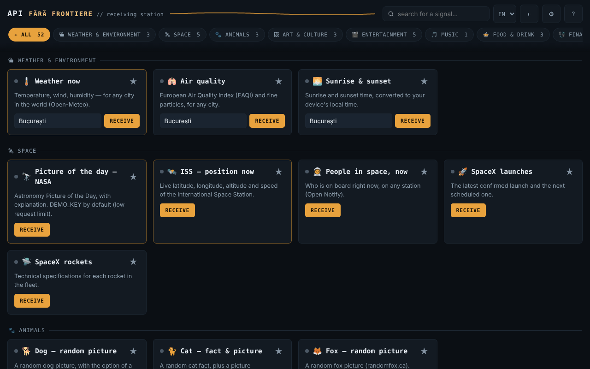

# API fără frontiere — receiving station · v1.1.0

**English** · [Română](README.ro.md) · [Français](README.fr.md) · [Italiano](README.it.md) · [Español](README.es.md) · [Português](README.pt.md) · [Deutsch](README.de.md) · [Magyar](README.hu.md)

**Version:** 1.2.1 · **Last updated:** 2026-10-22

Interface languages: **Română, English, Français, Italiano, Español, Português (PT), Deutsch, Magyar**

A single HTML file with 52 widgets (47 over public APIs — weather, space, art, books, exchange rates, password check, etc. — and 5 local utilities that work offline), with no account, no telemetry of its own, and no server of its own.

**Live app:** https://chiuta.github.io/API-fara-frontiere/

## What it is

An index page of "stations": each card queries a free public API directly from your browser and displays the result. There is no intermediary server run by the author. Unlike the offline apps in the same series, this one **needs internet** to display data: the file itself does not contain the data, only the interface.

The 52 widgets are grouped into 16 categories: Weather & Environment, Space, Animals, Art & Culture, Entertainment, Music, Food & Drink, Finance & Crypto, Countries & Geography, Words & Knowledge, Humour & Inspiration, Security, Health, Identity & Test Data, Development & Utilities, Local · no network.

## Features

Verified in the code and in automated tests with mocked responses (I could not use the external network during verification):

- 52 cards (47 online + 5 local), with search (diacritics-insensitive), filtering by category and favourites (★, kept locally).
- Every request has a 12 s timeout; on failure the card displays the cause (network unavailable, timed out, HTTP nnn) and a "Retry" button. The request button is disabled while a request is in progress; Enter in the fields triggers the request.
- Data received from the APIs is escaped before display; external links are accepted only if they are `http(s)`.
- "Compromised password?": computes SHA-1 locally and sends only the first 5 characters of the hash to Have I Been Pwned (k-anonymity); the password never leaves the browser.
- **Local · no network** (no requests, work offline): password generator (`crypto.getRandomValues`, bias-free, estimated entropy), UUID v4, text hash (SHA-256/384/512, SHA-1, Web Crypto — requires a secure context), Unix time ↔ date, Base64 UTF-8; "Copy" button.
- **Offline:** a warning bar when you have no connection (with a shortcut to the local cards); on a network error/timeout, the card shows below the error the last successful result, kept locally as text (optional, can be disabled and deleted from Settings; it is not kept for "Compromised password?", "My IP address" and the local cards).
- Optional NASA key (Settings ⚙), `DEMO_KEY` by default.
- Dark/light theme, Settings, "Sources and attributions".

## User guide

1. Open the page. The 3 main stations (Weather now, NASA Picture of the Day, ISS) load by themselves; you can turn this off in Settings ⚙ (it applies on the next opening).
2. Look for a card in the top field or choose a category from the filter bar.
3. Fill in the card's field (city, name, code, etc.), if there is one, and press **Receive** (or Enter).
4. If "Signal lost" appears, press **Retry** or try later: third-party sources may be unavailable or may rate-limit.
5. Mark your favourite cards with ★ so they appear first in their category.
6. In Settings ⚙ you can save your own NASA key (free, from api.nasa.gov) and turn off automatic loading; "Sources and attributions" lists the providers.

## Privacy and network

- **Local storage (`localStorage`):** `aff_theme` (theme), `aff_favs` (favourites), `aff_nasa_key` (the NASA key, in clear text, if you save it), `aff_auto_hero` (automatic loading), `aff_last` (the last result of the cards, as text, max. 600 characters per card) and `aff_keep_last` (the option to keep it). No cookies, `sessionStorage` or IndexedDB are used. If storage is blocked (private mode), the app works without it.
- **On opening, 3 sources are contacted automatically** (unless you turn off automatic loading in Settings): `geocoding-api.open-meteo.com` and `api.open-meteo.com` (the city in the "Weather now" card, Bucharest by default), `api.nasa.gov` (your key or `DEMO_KEY`; plus the image from `apod.nasa.gov`) and `api.wheretheiss.at`. With automatic loading turned off, no request is sent on opening (tested).
- **All the other cards contact their source only after you press the button** in the card. What you type (city, name, VAT number, VIN, barcode, text for the QR code, etc.) is sent to that source; text for the QR code goes to `api.qrserver.com`.
- Every source contacted sees your IP address. Requests are sent without cookies and without a Referer header.
- The page has a `Content-Security-Policy` (meta); the app's own script is allowed via a SHA-256 hash (no `'unsafe-inline'` in `script-src`), and `connect-src` is a list of domains: `connect-src` contains exactly the hosts called by the code (verified by inventory). The image list (`img-src`) also includes hosts where images are indicated by the API responses (e.g. `image.tmdb.org`, `*.archive.org`, `raw.githubusercontent.com`); these could not be confirmed without network access.
- API hosts: open-meteo (3 subdomains), sunrise-sunset.org, nasa.gov, wheretheiss.at, open-notify.org, spacexdata.com, dog.ceo, catfact.ninja, randomfox.ca, artic.edu, metmuseum.org, openlibrary.org, ghibliapi.vercel.app, tvmaze.com, rickandmortyapi.com, pokeapi.co, deckofcardsapi.com, itunes.apple.com, themealdb.com, thecocktaildb.com, openfoodfacts.org, frankfurter.dev, coingecko.com, vatcomply.com, restcountries.com, date.nager.at, dictionaryapi.dev, ro/en.wikipedia.org, numbersapi.com, opentdb.com, jokeapi.dev, chucknorris.io, adviceslip.com, pwnedpasswords.com, api.fda.gov, disease.sh, genderize.io, agify.io, nationalize.io, randomuser.me, api.github.com, hacker-news.firebaseio.com, vpic.nhtsa.dot.gov, universities.hipolabs.com, ipapi.co.
- Browser permissions: none.

## Limits and warnings

- The app has no control over the APIs: they may go down, change their format, rate-limit or return stale data. I could not verify from the test environment the availability, CORS, keys or current limits of any of them; each provider's terms must be consulted directly at the source. Known to be fragile/unverified: Open Notify (HTTP only, insecure), SpaceX-API (community data, possibly out of date), NumbersAPI, disease.sh (archive), CoinGecko and ipapi.co (limits for keyless access), TheMealDB/TheCocktailDB (public test key).
- The data in the widgets is informational. **Drug label (FDA):** text in English, only for US products; it is not medical advice and does not replace the doctor or pharmacist. **Exchange rate, cryptocurrencies, VAT:** not financial advice or official confirmation. **Prediction from a first name:** a statistical estimate, often wrong; do not use it for decisions about people.
- Images from NASA, museums, TVmaze, etc. may be subject to copyright or their own licences; the NASA card displays the credit when provided. See "Sources and attributions" in the app.
- The "Chuck Norris Fact" widget displays absurd jokes taken from a third-party API (the "explicit" category is avoided, filtering is not guaranteed).
- Verified with mocked responses, not with the real servers.

## Running locally / offline

Download `index.html` and open it in a browser. The interface starts without internet, but the cards display data only with an internet connection.

## History / Changelog

### 1.2.1 — 2026-10-22
- The page title (document.title) now follows the interface language instead of keeping the Romanian suffix.

### 1.1.0 — 2026-10-14
- Backup and data labelling (fff-kit).

### 12 October 2026 — version 1.0.4
- 1.0.4 — 2026-10-12: the version and the date of the last update are displayed in the app

### 11 October 2026 (third pass) — version 1.0.3
- Automatic loading of the 3 stations no longer starts while the browser reports "offline" (no needless red errors); deferred requests run once on reconnection. Print style (only the stations, no controls). CSP: hash recalculated.

### 11 October 2026 (second pass) — version 1.0.2
- New category "Local · no network" with 5 utilities that work without internet (password generator, UUID v4, hash, Unix time, Base64); offline bar; the last saved result appears below network errors (optional, deletable); 52 widgets in 16 categories; CSP: hash recalculated (no new hosts).

### 11 October 2026
- Version 1.0.1 (displayed in "About the station").
- Accessibility: the title "API fără frontiere" is now an `<h1>`, and the card titles are `<h2>` (correct heading order); axe-core reports 0 violations at 1280 and 360 px.
- CSP: `script-src` uses a SHA-256 hash instead of `'unsafe-inline'`.
- The "Sources and attributions" window explicitly notes that the availability/format of the APIs could not be re-verified on 11 October 2026 (no network access); the "Compromised password?" widget was retested with a mocked response (it works).

**Sources verified on 11.10.2026:** none: the status of third-party APIs (NumbersAPI, disease.sh, SpaceX-API, ipapi.co, etc.) could not be confirmed from primary sources on 11.10.2026; the list keeps the existing warning.

## License

MIT — see the LICENSE file.

## Author

Alexio — Alexandru-Ionuț Chiuță, contact: alexio@trom.tf

## Summary

API fără frontiere is a single-file HTML dashboard of 52 widgets (47 over free public APIs plus 5 local tools that work offline) (weather, space, art, books, currency, password breach check, etc.), with no account and no telemetry of its own. Unlike the offline apps in this series it needs internet to show data. Three widgets (weather, NASA picture, ISS) load automatically on open unless disabled in Settings; every other widget contacts its source only when you press its button, and each source sees your IP address. Data was tested against mocked responses only; third-party API availability and terms are not verified. Licence: MIT (see LICENSE).
