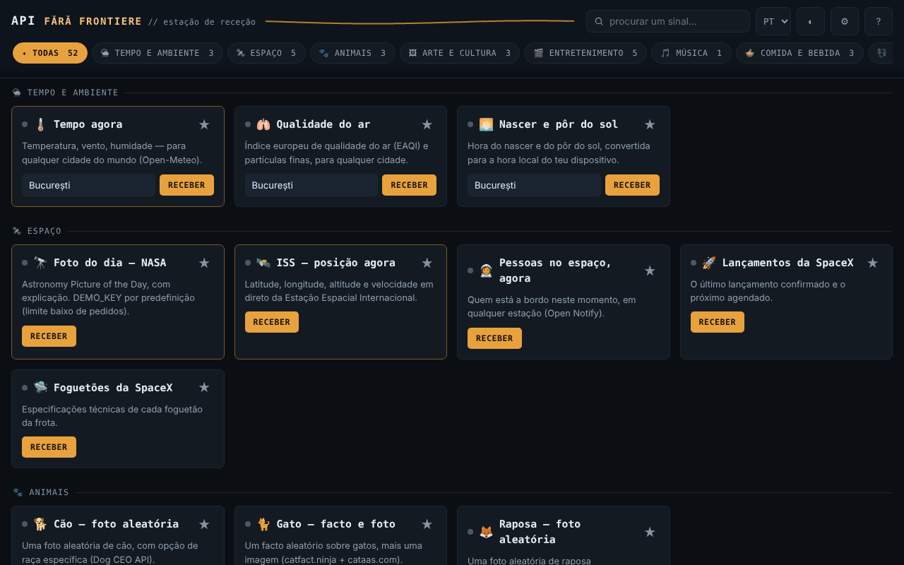

# API fără frontiere — estação de receção · v1.1.0

[English](README.md) · [Română](README.ro.md) · [Français](README.fr.md) · [Italiano](README.it.md) · [Español](README.es.md) · **Português** · [Deutsch](README.de.md) · [Magyar](README.hu.md)

**Versão:** 2.0.0 · **Última atualização:** 2026-10-26

Idiomas da interface: **Română, English, Français, Italiano, Español, Português (PT), Deutsch, Magyar**

Um único ficheiro HTML com 52 widgets (47 sobre APIs públicas — meteorologia, espaço, arte, livros, taxas de câmbio, verificação de palavras-passe, etc. — e 5 utilitários locais que funcionam offline), sem conta, sem telemetria própria, sem servidor próprio.

**Aplicação online:** https://chiuta.github.io/API-fara-frontiere/

## O que é

Uma página-índice de «estações»: cada cartão consulta diretamente, a partir do seu navegador, uma API pública gratuita e apresenta o resultado. Não existe nenhum servidor intermédio do autor. Ao contrário das aplicações offline da mesma série, esta **precisa de internet** para apresentar dados: o ficheiro em si não contém os dados, apenas a interface.

Os 52 widgets estão agrupados em 16 categorias: Meteorologia & Ambiente, Espaço, Animais, Arte & Cultura, Entretenimento, Música, Comida & Bebida, Finanças & Cripto, Países & Geografia, Palavras & Conhecimento, Humor & Inspiração, Segurança, Saúde, Identidade & Dados de teste, Desenvolvimento & Utilitários, Local · sem rede.

## Funcionalidades

Verificadas no código e em testes automáticos com respostas simuladas (não pude usar a rede externa durante a verificação):

- **Novo na 2.0.0 — Laboratório de pedidos (botão ⚗):** coleções GET locais, ambientes com variáveis, asserções sobre a resposta, execução em cadeia, comparação com a execução anterior, importação/exportação JSON e cURL; só hosts já permitidos pela CSP.
- 52 cartões (47 online + 5 locais), com pesquisa (sem distinção de sinais diacríticos), filtragem por categoria e favoritos (★, guardados localmente).
- Cada pedido tem um tempo limite de 12 s; em caso de falha o cartão apresenta a causa (rede indisponível, tempo esgotado, HTTP nnn) e um botão «Tentar novamente». O botão do pedido fica bloqueado enquanto um pedido está em curso; Enter nos campos aciona o pedido.
- Os dados recebidos das APIs são escapados antes de apresentados; as ligações externas só são aceites se forem `http(s)`.
- «Palavra-passe comprometida?»: calcula o SHA-1 localmente e envia ao Have I Been Pwned apenas os primeiros 5 carateres da impressão digital (k-anonimato); a palavra-passe não sai do navegador.
- **Local · sem rede** (sem pedidos, funcionam offline): gerador de palavras-passe (`crypto.getRandomValues`, sem enviesamento, entropia estimada), UUID v4, hash de texto (SHA-256/384/512, SHA-1, Web Crypto — requer contexto seguro), tempo Unix ↔ data, Base64 UTF-8; botão «Copiar».
- **Offline:** barra de aviso quando não tem ligação (com um atalho para os cartões locais); perante um erro de rede/tempo esgotado, o cartão mostra por baixo do erro o último resultado bem-sucedido, guardado localmente como texto (opcional, pode ser desativado e apagado nas Definições; não é guardado para «Palavra-passe comprometida?», «O meu endereço IP» e os cartões locais).
- Chave NASA opcional (Definições ⚙), `DEMO_KEY` por predefinição.
- Tema escuro/claro, Definições, «Fontes e atribuições».

## Manual de utilização

1. Abra a página. As 3 estações principais (O tempo agora, Foto do dia da NASA, ISS) carregam-se sozinhas; pode desativar isso nas Definições ⚙ (aplica-se na próxima abertura).
2. Procure um cartão no campo superior ou escolha uma categoria na barra de filtros.
3. Preencha o campo do cartão (cidade, nome, código, etc.), se existir, e prima **Receber** (ou Enter).
4. Se aparecer «Sinal perdido», prima **Tentar novamente** ou tente mais tarde: as fontes de terceiros podem estar indisponíveis ou limitar o tráfego.
5. Marque os seus cartões preferidos com ★ para que apareçam primeiro na respetiva categoria.
6. Nas Definições ⚙ pode guardar uma chave NASA própria (gratuita, em api.nasa.gov) e desativar o carregamento automático; «Fontes e atribuições» lista os fornecedores.

## Privacidade e rede

- **Armazenamento local (`localStorage`):** `aff_theme` (tema), `aff_favs` (favoritos), `aff_nasa_key` (a chave NASA, em claro, se a guardar), `aff_auto_hero` (carregamento automático), `aff_last` (último resultado dos cartões, como texto, máx. 600 carateres por cartão) e `aff_keep_last` (a opção de o guardar). Não são usados cookies, `sessionStorage` nem IndexedDB. Se o armazenamento estiver bloqueado (modo privado), a aplicação funciona sem ele.
- **Ao abrir, são contactadas automaticamente 3 fontes** (se não desativar o carregamento automático nas Definições): `geocoding-api.open-meteo.com` e `api.open-meteo.com` (a cidade do cartão «O tempo agora», Bucareste por predefinição), `api.nasa.gov` (a sua chave ou `DEMO_KEY`; mais a imagem de `apod.nasa.gov`) e `api.wheretheiss.at`. Com o carregamento automático desativado, ao abrir não é enviado nenhum pedido (testado).
- **Todos os outros cartões só contactam a fonte depois de premir o botão** do cartão. O que escreve (cidade, nome, NIF-IVA, VIN, código de barras, texto para o QR, etc.) é enviado à respetiva fonte; o texto para o código QR vai para `api.qrserver.com`.
- Cada fonte contactada vê o seu endereço IP. Os pedidos são enviados sem cookies e sem cabeçalho Referer.
- A página tem uma `Content-Security-Policy` (meta); o script próprio é permitido por hash SHA-256 (sem `'unsafe-inline'` em `script-src`), e `connect-src` é uma lista de domínios: `connect-src` contém exatamente os anfitriões chamados pelo código (verificado por inventário). A lista de imagens (`img-src`) inclui também anfitriões em que as imagens são indicadas pelas respostas das APIs (p. ex. `image.tmdb.org`, `*.archive.org`, `raw.githubusercontent.com`); não foi possível confirmá-lo sem rede.
- Anfitriões das APIs: open-meteo (3 subdomínios), sunrise-sunset.org, nasa.gov, wheretheiss.at, open-notify.org, spacexdata.com, dog.ceo, catfact.ninja, randomfox.ca, artic.edu, metmuseum.org, openlibrary.org, ghibliapi.vercel.app, tvmaze.com, rickandmortyapi.com, pokeapi.co, deckofcardsapi.com, itunes.apple.com, themealdb.com, thecocktaildb.com, openfoodfacts.org, frankfurter.dev, coingecko.com, vatcomply.com, restcountries.com, date.nager.at, dictionaryapi.dev, ro/en.wikipedia.org, numbersapi.com, opentdb.com, jokeapi.dev, chucknorris.io, adviceslip.com, pwnedpasswords.com, api.fda.gov, disease.sh, genderize.io, agify.io, nationalize.io, randomuser.me, api.github.com, hacker-news.firebaseio.com, vpic.nhtsa.dot.gov, universities.hipolabs.com, ipapi.co.
- Permissões do navegador: nenhuma.

## Limites e avisos

- A aplicação não tem controlo sobre as APIs: podem cair, mudar de formato, limitar os pedidos ou devolver dados antigos. Não consegui verificar a partir do ambiente de teste a disponibilidade, o CORS, as chaves ou os limites atuais de nenhuma delas; as condições de cada fornecedor devem ser consultadas diretamente na fonte. Conhecidas como frágeis/não verificadas: Open Notify (apenas HTTP, inseguro), SpaceX-API (dados da comunidade, possivelmente desatualizados), NumbersAPI, disease.sh (arquivo), CoinGecko e ipapi.co (limites para acesso sem chave), TheMealDB/TheCocktailDB (chave pública de teste).
- Os dados dos widgets são informativos. **Folheto de medicamento (FDA):** texto em inglês, apenas para produtos dos EUA; não é aconselhamento médico nem substitui o médico ou o farmacêutico. **Taxa de câmbio, criptomoedas, IVA:** não são aconselhamento financeiro nem confirmação oficial. **Previsão a partir do nome próprio:** estimativa estatística, muitas vezes errada; não a use para decisões sobre pessoas.
- As imagens da NASA, museus, TVmaze, etc. podem ter direitos de autor ou licenças próprias; o cartão da NASA apresenta o crédito quando fornecido. Veja «Fontes e atribuições» na aplicação.
- O widget «Facto Chuck Norris» apresenta piadas absurdas retiradas de uma API de terceiros (evita-se a categoria «explicit», a filtragem não é garantida).
- Verificado com respostas simuladas, não com os servidores reais.

## Execução local / offline

Transfira `index.html` e abra-o no navegador. A interface arranca sem internet, mas os cartões só apresentam dados com ligação à internet.

## Histórico / Changelog

### 1.2.4 — 2026-10-22
- fff-kit 1.1.4: alvos de toque e tamanho mínimo do texto

### 1.2.3 — 2026-10-22
- fff-kit 1.1.2: PBKDF2 600 000 iterações, proteção anti-clickjacking

### 1.2.1 — 2026-10-22
- O título da página (document.title) acompanha agora o idioma da interface, em vez de manter o sufixo romeno.

### 1.1.0 — 2026-10-14
- Cópia de segurança e etiquetagem de dados (fff-kit).

### 12 de outubro de 2026 — versão 1.0.4
- 1.2.2 — 2026-10-22: Banner de consentimento antes de as estações da página inicial (NASA APOD, ISS, meteorologia) contactarem terceiros (até aceitar não é feito nenhum pedido); NASA APOD em cache por dia; a dica DEMO_KEY só aparece quando se usa DEMO_KEY; alert() nativo substituído por um aviso na página; texto ≥ 12 px, alvos maiores e sem overflow horizontal a 360 px.

- 1.0.4 — 2026-10-12: a versão e a data da última atualização são apresentadas na aplicação

### 11 de outubro de 2026 (terceira passagem) — versão 1.0.3
- O carregamento automático das 3 estações deixa de arrancar enquanto o navegador indicar «offline» (sem erros vermelhos inúteis); os pedidos adiados são executados uma única vez ao restabelecer a ligação. Estilo de impressão (apenas as estações, sem controlos). CSP: hash recalculado.

### 11 de outubro de 2026 (segunda passagem) — versão 1.0.2
- Nova categoria «Local · sem rede» com 5 utilitários que funcionam sem internet (gerador de palavras-passe, UUID v4, hash, tempo Unix, Base64); barra offline; o último resultado guardado aparece por baixo dos erros de rede (opcional, apagável); 52 widgets em 16 categorias; CSP: hash recalculado (sem novos anfitriões).

### 11 de outubro de 2026
- Versão 1.0.1 (apresentada em «Sobre a estação»).
- Acessibilidade: o título «API fără frontiere» passa a ser um `<h1>` e os títulos dos cartões são `<h2>` (ordem correta dos títulos); o axe-core reporta 0 violações a 1280 e 360 px.
- CSP: `script-src` usa um hash SHA-256 em vez de `'unsafe-inline'`.
- A janela «Fontes e atribuições» indica explicitamente que a disponibilidade/o formato das APIs não puderam ser reverificados a 11 de outubro de 2026 (sem acesso à rede); o widget «Palavra-passe comprometida?» foi retestado com uma resposta simulada (funciona).

**Fontes verificadas em 11.10.2026:** nenhuma: o estado das APIs de terceiros (NumbersAPI, disease.sh, SpaceX-API, ipapi.co, etc.) não pôde ser confirmado em fontes primárias em 11.10.2026; a lista mantém o aviso existente.

## Licença

MIT — ver o ficheiro LICENSE.

## Autor

Alexio — Alexandru-Ionuț Chiuță, contacto: alexio@trom.tf

## Resumo

API fără frontiere é um painel HTML num único ficheiro com 52 widgets (47 sobre APIs públicas gratuitas mais 5 ferramentas locais que funcionam offline) (meteorologia, espaço, arte, livros, moedas, verificação de fuga de palavras-passe, etc.), sem conta e sem telemetria própria. Ao contrário das aplicações offline desta série, precisa de internet para apresentar dados. Três widgets (meteorologia, imagem da NASA, ISS) carregam automaticamente ao abrir, salvo se forem desativados nas Definições; todos os outros widgets só contactam a respetiva fonte quando prime o seu botão, e cada fonte vê o seu endereço IP. Os dados foram testados apenas com respostas simuladas; a disponibilidade e as condições das APIs de terceiros não estão verificadas. Licença: MIT (ver LICENSE).
