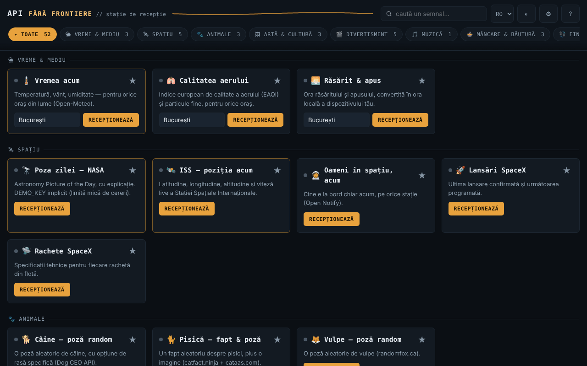

# API fără frontiere — stație de recepție · v1.1.0

[English](README.md) · **Română** · [Français](README.fr.md) · [Italiano](README.it.md) · [Español](README.es.md) · [Português](README.pt.md) · [Deutsch](README.de.md) · [Magyar](README.hu.md)

**Versiune:** 1.2.1 · **Ultima actualizare:** 2026-10-22

Limbile interfeței: **Română, English, Français, Italiano, Español, Português (PT), Deutsch, Magyar**

Un singur fișier HTML cu 52 de widgeturi (47 peste API-uri publice — meteo, spațiu, artă, cărți, curs valutar, verificare parolă etc. — și 5 utilitare locale care merg offline), fără cont, fără telemetrie proprie, fără server propriu.

**Live:** https://chiuta.github.io/API-fara-frontiere/

## Ce este

O pagină-index de „stații”: fiecare card interoghează direct, din browserul tău, un API public gratuit și afișează rezultatul. Nu există server intermediar al autorului. Spre deosebire de aplicațiile offline din aceeași serie, aceasta **are nevoie de internet** pentru a afișa date: fișierul în sine nu conține datele, ci doar interfața.

Cele 52 de widgeturi sunt grupate în 16 categorii: Vreme & Mediu, Spațiu, Animale, Artă & Cultură, Divertisment, Muzică, Mâncare & Băutură, Finanțe & Cripto, Țări & Geografie, Cuvinte & Cunoaștere, Umor & Inspirație, Securitate, Sănătate, Identitate & Date test, Dezvoltare & Utilitare, Local · fără rețea.

## Funcții

Verificate în cod și în teste automate cu răspunsuri simulate (nu am putut folosi rețeaua externă la verificare):

- 52 de carduri (47 online + 5 locale), cu căutare (fără diacritice), filtrare pe categorie și favorite (★, păstrate local).
- Fiecare cerere are timeout de 12 s; la eșec cardul afișează cauza (rețea indisponibilă, timp depășit, HTTP nnn) și un buton „Reîncearcă”. Butonul de cerere este blocat cât timp o cerere e în curs; Enter în câmpuri declanșează cererea.
- Datele primite de la API-uri sunt escapate înainte de afișare; legăturile externe sunt acceptate doar dacă sunt `http(s)`.
- „Parolă compromisă?”: calculează local SHA-1 și trimite către Have I Been Pwned doar primele 5 caractere ale amprentei (k-anonimat); parola nu pleacă din browser.
- **Local · fără rețea** (nicio cerere, merg offline): generator de parole (`crypto.getRandomValues`, fără bias, entropie estimată), UUID v4, hash de text (SHA-256/384/512/SHA-1, Web Crypto — cere context sigur), timp Unix ↔ dată, Base64 UTF-8; buton „Copiază”.
- **Offline:** bară de avertizare când nu ai conexiune (cu scurtătură spre cardurile locale); la eroare de rețea/timeout, cardul arată sub eroare ultimul rezultat reușit, păstrat local ca text (opțional, dezactivabil și ștergibil din Setări; nu se păstrează pentru „Parolă compromisă?”, „Adresa mea IP” și cardurile locale).
- Cheie NASA opțională (Setări ⚙), implicit `DEMO_KEY`.
- Temă întunecată/luminoasă, Setări, „Surse și atribuiri”.

## Manual de utilizare

1. Deschide pagina. Cele 3 stații principale (Vremea acum, Poza zilei NASA, ISS) se încarcă singure; poți opri asta din Setări ⚙ (se aplică la următoarea deschidere).
2. Caută un card în câmpul de sus sau alege o categorie din bara de filtre.
3. Completează câmpul cardului (oraș, nume, cod etc.), dacă există, și apasă **Recepționează** (sau Enter).
4. Dacă apare „Semnal pierdut”, apasă **Reîncearcă** sau încearcă mai târziu: sursele terțe pot fi indisponibile sau pot limita traficul.
5. Marchează cardurile preferate cu ★ ca să apară primele în categoria lor.
6. În Setări ⚙ poți salva o cheie NASA proprie (gratuită, de la api.nasa.gov) și poți opri încărcarea automată; „Surse și atribuiri” listează furnizorii.

## Confidențialitate și rețea

- **Stocare locală (`localStorage`):** `aff_theme` (temă), `aff_favs` (favorite), `aff_nasa_key` (cheia NASA, în clar, dacă o salvezi), `aff_auto_hero` (încărcare automată), `aff_last` (ultimul rezultat al cardurilor, ca text, max. 600 de caractere per card) și `aff_keep_last` (opțiunea de a-l păstra). Nu se folosesc cookie-uri, `sessionStorage` sau IndexedDB. Dacă stocarea este blocată (mod privat), aplicația funcționează fără ea.
- **La deschidere se contactează automat 3 surse** (dacă nu dezactivezi încărcarea automată din Setări): `geocoding-api.open-meteo.com` și `api.open-meteo.com` (orașul din cardul „Vremea acum”, implicit București), `api.nasa.gov` (cheia ta sau `DEMO_KEY`; plus imaginea de pe `apod.nasa.gov`) și `api.wheretheiss.at`. Cu încărcarea automată oprită, la deschidere nu se trimite nicio cerere (testat).
- **Toate celelalte carduri contactează sursa doar după ce apeși butonul** din card. Ce tastezi (oraș, nume, cod TVA, VIN, cod de bare, text pentru QR etc.) este trimis sursei respective; text pentru codul QR merge la `api.qrserver.com`.
- Fiecare sursă contactată îți vede adresa IP. Cererile sunt trimise fără cookie-uri și fără antet Referer.
- Pagina are un `Content-Security-Policy` (meta); scriptul propriu este permis prin hash SHA-256 (fără `'unsafe-inline'` în `script-src`), iar `connect-src` este o listă de domenii: `connect-src` conține exact gazdele apelate de cod (verificat prin inventar). Lista de imagini (`img-src`) include și gazde în care imaginile sunt indicate de răspunsurile API-urilor (de ex. `image.tmdb.org`, `*.archive.org`, `raw.githubusercontent.com`); acestea nu au putut fi confirmate fără rețea.
- Gazde API: open-meteo (3 subdomenii), sunrise-sunset.org, nasa.gov, wheretheiss.at, open-notify.org, spacexdata.com, dog.ceo, catfact.ninja, randomfox.ca, artic.edu, metmuseum.org, openlibrary.org, ghibliapi.vercel.app, tvmaze.com, rickandmortyapi.com, pokeapi.co, deckofcardsapi.com, itunes.apple.com, themealdb.com, thecocktaildb.com, openfoodfacts.org, frankfurter.dev, coingecko.com, vatcomply.com, restcountries.com, date.nager.at, dictionaryapi.dev, ro/en.wikipedia.org, numbersapi.com, opentdb.com, jokeapi.dev, chucknorris.io, adviceslip.com, pwnedpasswords.com, api.fda.gov, disease.sh, genderize.io, agify.io, nationalize.io, randomuser.me, api.github.com, hacker-news.firebaseio.com, vpic.nhtsa.dot.gov, universities.hipolabs.com, ipapi.co.
- Permisiuni de browser: niciuna.

## Limite și avertismente

- Aplicația nu are control asupra API-urilor: pot pica, își pot schimba formatul, limita cererile sau pot returna date vechi. Nu am putut verifica din mediul de testare disponibilitatea, CORS-ul, cheile sau limitele actuale ale niciunuia dintre ele; condițiile fiecărui furnizor trebuie consultate direct la sursă. Cunoscut ca fragil/neverificat: Open Notify (doar HTTP/HTTPS nesigur), SpaceX-API (date comunitare, posibil neactualizate), NumbersAPI, disease.sh (arhivă), CoinGecko și ipapi.co (limite pentru acces fără cheie), TheMealDB/TheCocktailDB (cheie publică de test).
- Datele din widgeturi sunt informative. **Etichetă medicament (FDA):** text în engleză, doar pentru produse din SUA; nu e sfat medical, nu înlocuiește medicul sau farmacistul. **Curs valutar, criptomonede, TVA:** nu sunt sfat financiar sau confirmare oficială. **Predicție din prenume:** estimare statistică, adesea greșită; nu o folosi pentru decizii despre persoane.
- Imaginile de la NASA, muzei, TVmaze etc. pot avea drepturi de autor sau licențe proprii; cardul NASA afișează creditul când este furnizat. Vezi „Surse și atribuiri” în aplicație.
- Widgetul „Fapt Chuck Norris” afișează glume absurde preluate dintr-un API terț (se evită categoria „explicit”, filtrarea nu e garantată).
- Verificat cu răspunsuri simulate, nu cu serverele reale.

## Rulare locală / offline

Descarcă `index.html` și deschide-l în browser. Interfața pornește fără internet, dar cardurile afișează date doar cu conexiune la internet.

## Istoric / Changelog

### 1.2.1 — 2026-10-22
- Titlul paginii (document.title) urmează acum limba interfeței, nu mai păstrează sufixul românesc.

### 1.1.0 — 2026-10-14
- Copie de rezervă și etichetare date (fff-kit).

### 12 octombrie 2026 — versiunea 1.0.4
- 1.0.4 — 2026-10-12: versiunea și data ultimei actualizări sunt afișate în aplicație

### 11 octombrie 2026 (a treia trecere) — versiunea 1.0.3
- Încărcarea automată a celor 3 stații nu mai pornește cât timp browserul raportează „offline” (fără erori roșii inutile); cererile amânate rulează o singură dată la reconectare. Stil de tipărire (doar stațiile, fără comenzi). CSP: hash recalculat.

### 11 octombrie 2026 (a doua trecere) — versiunea 1.0.2
- Categorie nouă „Local · fără rețea” cu 5 utilitare care funcționează fără internet (generator de parole, UUID v4, hash, timp Unix, Base64); bară offline; ultimul rezultat salvat apare sub erorile de rețea (opțional, ștergibil); 52 de widgeturi în 16 categorii; CSP: hash recalculat (fără gazde noi).

### 11 octombrie 2026
- Versiune 1.0.1 (afișată în „Despre stație”).
- Accesibilitate: titlul „API fără frontiere” este acum `<h1>`, iar titlurile cardurilor sunt `<h2>` (ordine corectă a titlurilor); axe-core raportează 0 încălcări la 1280 și 360 px.
- CSP: `script-src` folosește hash SHA-256 în loc de `'unsafe-inline'`.
- Fereastra „Surse și atribuiri” notează explicit că disponibilitatea/formatul API-urilor nu au putut fi reverificate la 11 octombrie 2026 (fără acces la rețea); widgetul „Parolă compromisă?” a fost retestat cu răspuns simulat (funcționează).

**Surse verificate la 11.10.2026:** niciuna: statusul API-urilor terțe (NumbersAPI, disease.sh, SpaceX-API, ipapi.co etc.) nu a putut fi confirmat de pe surse primare la 11.10.2026; lista rămâne cu avertismentul existent.

## Licență

MIT — vezi fișierul LICENSE.

## Autor

Alexio — Alexandru-Ionuț Chiuță, contact: alexio@trom.tf

## Rezumat

API fără frontiere este un panou într-un singur fișier HTML cu 52 de widgeturi (47 peste API-uri publice gratuite plus 5 instrumente locale care funcționează offline) (meteo, spațiu, artă, cărți, curs valutar, verificarea parolelor compromise etc.), fără cont și fără telemetrie proprie. Spre deosebire de aplicațiile offline din această serie, are nevoie de internet pentru a afișa date. Trei widgeturi (meteo, imaginea NASA, ISS) se încarcă automat la deschidere, dacă nu sunt dezactivate în Setări; fiecare alt widget contactează sursa doar când apeși butonul său, iar fiecare sursă îți vede adresa IP. Datele au fost testate doar cu răspunsuri simulate; disponibilitatea și termenii API-urilor terților nu sunt verificate. Licență: MIT (vezi LICENSE).
